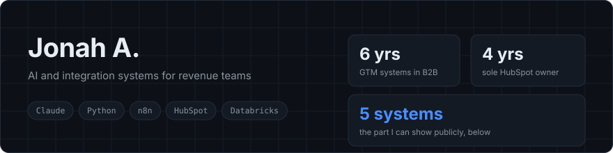
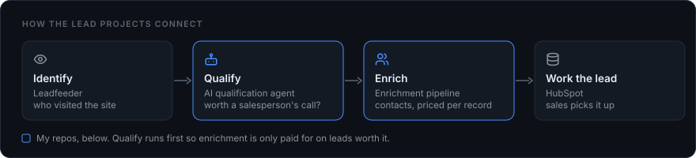
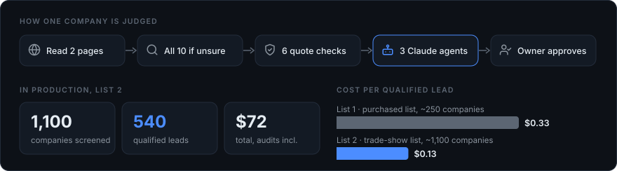
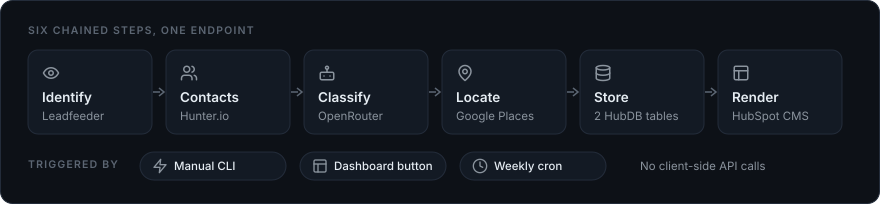
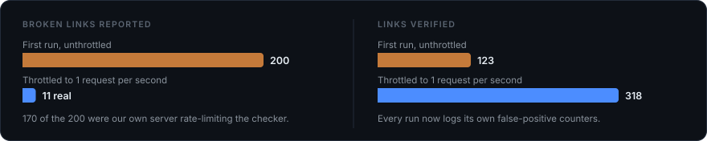
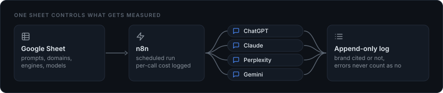
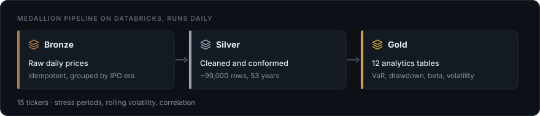

I build AI and integration systems for small and mid-size revenue teams: the pipelines between the website, the CRM, the ERP and the sales team. Six years running GTM systems in B2B, four of them as sole owner and admin of a HubSpot platform covering automation, CRM, integrations, and pipeline reporting.

These days I don't just run the systems, I build them: Claude agents, Python ETL, REST API integrations, n8n workflows, and scheduled pipelines. The work below is the part I can show publicly.

### Things I have built

**[b2b-ai-lead-qualification-agent](https://github.com/jnhmac/b2b-ai-lead-qualification-agent)**  
Reads a manufacturer's website and decides whether it is a qualified lead, attaching the sentence from the company's own site that proves it. Reads two pages before paying for ten, runs six checks on every quote, and has three Claude agents review each batch before a person approves it. In production: about 1,100 companies screened, 540 qualified leads, $72 in total. A case study, with the code available as a walkthrough on request.

**[b2b-lead-enrichment-pipeline](https://github.com/jnhmac/b2b-lead-enrichment-pipeline)**  
Turns anonymous website visitors into scored, contact-ready sales leads. Six Python steps chain Leadfeeder, Hunter.io, OpenRouter, and Google Places, then write two linked HubDB tables that a HubSpot CMS page renders with no client-side API calls. Addresses and phone numbers come from regex extraction rather than the LLM, so the model never invents a plausible-looking wrong address. A manual CLI, a dashboard button, and a weekly Cloud Scheduler cron all hit the same FastAPI endpoint on Cloud Run.

**[hubspot-broken-link-monitor](https://github.com/jnhmac/hubspot-broken-link-monitor)**  
Link integrity checks for a HubSpot CMS site, built while consolidating a multi-subdomain setup onto a single root domain. Reads pages and posts through the CMS API rather than crawling, so it sees drafts and theme-module markup a crawler cannot. The substance is what it refuses to report: the first run flagged 200 broken links, 170 of which were our own server rate-limiting concurrent requests. Throttling to one request per second took verified links from 123 to 318 and the real count to 11. Every run logs its own false-positive counters.

**[llm-citation-tracker](https://github.com/jnhmac/llm-citation-tracker)**  
Measures how often AI answer engines cite your brand, across ChatGPT, Claude, Perplexity, and Gemini. Config-driven n8n workflow: prompts, tracked domains, engines, and model choices all live in a Google Sheet, so a marketer changes what is measured without anyone touching the automation. Append-only output, per-call cost logging, and error rows that never fake a negative result.

**[market-risk-analytics-engine](https://github.com/jnhmac/market-risk-analytics-engine)**  
A Databricks medallion pipeline over 53 years of daily market data, roughly 99,000 rows across 15 tickers. Bronze ingestion is idempotent and grouped by IPO era so a backfill does not waste API budget on date ranges that never existed. Gold produces twelve analytics tables covering Value at Risk, stress-period performance, drawdown, rolling volatility, correlation, and beta. Runs daily on a scheduled job.

### Stack

Claude (Claude Code agents, MCP), OpenRouter  
Python, FastAPI, TypeScript, Next.js, Astro  
n8n, Databricks, PySpark, Delta Lake  
HubSpot, Google Search Console, GA4  
Firebase, SQLite, Docker, Cloud Run, Netlify, Caddy, Cloudflare

### Elsewhere

[lmfinder.ai](https://lmfinder.ai) is a directory of LLM tools I am building.
